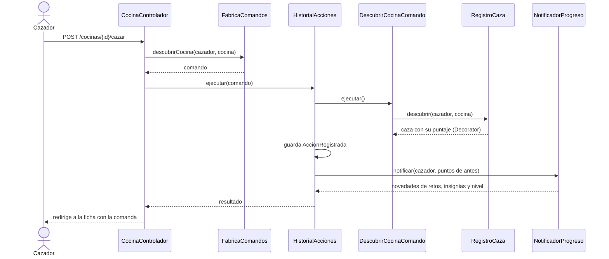

# GhostKitchen Hunter

[](https://github.com/NicolasSnchz/sanchez-ghostkitchen/actions/workflows/ci.yml)

Proyecto final de **Patrones de Diseño de Software** (UDES, Cúcuta). Nicolás Andrés Sánchez Villamizar.

En Cúcuta hay muchas cocinas fantasma: negocios que cocinan en una casa o en un garaje, no tienen local ni letrero y solo venden por domicilio. Son difíciles de encontrar porque casi no aparecen en los mapas y todo depende del voz a voz. GhostKitchen Hunter las junta en un mapa y convierte el encontrarlas en un juego: cada cocina que descubres es una **caza** que te da puntos según su rareza, con bonos por ser el primero, por mantener la racha o por cazar de noche. Hay reseñas, retos, insignias, niveles y un ranking. Y como cualquiera se equivoca, la última acción se puede **deshacer** durante 15 minutos: ese es el patrón **Command** que me asignaron, y es el corazón del proyecto.

> Las cocinas del catálogo son inventadas, pero los barrios y sus coordenadas son reales.

## Contenido

1. [Cómo ejecutarlo](#cómo-ejecutarlo)
2. [Recorrido por la aplicación](#recorrido-por-la-aplicación)
3. [Arquitectura](#arquitectura)
4. [Patrones de diseño](#patrones-de-diseño)
5. [El patrón Command en detalle](#el-patrón-command-en-detalle)
6. [Patrones que decidí no usar](#patrones-que-decidí-no-usar)
7. [Modelo de clases](#modelo-de-clases)
8. [Pruebas](#pruebas)
9. [Calidad y métricas](#calidad-y-métricas)
10. [Estructura del repositorio](#estructura-del-repositorio)
11. [Decisiones y documentos](#decisiones-y-documentos)

## Cómo ejecutarlo

Necesitas JDK 17 o superior y Maven 3.9.

```bash
mvn spring-boot:run
```

Luego abre <http://localhost:8080>. La base de datos es H2 en memoria y al arrancar se carga un catálogo de demostración (16 cocinas, 6 cazadores, 36 cazas y 5 retos con fechas relativas al día de hoy, así siempre hay retos vigentes).

| Cuenta | Correo | Clave | Qué tiene de especial |
|---|---|---|---|
| Cazador | `cazador@ghostkitchen.co` | `Cazador2026` | Lleva dos días de racha y le falta una cocina para completar un reto |
| Administración | `admin@ghostkitchen.co` | `Admin2026` | Gestiona el catálogo de cocinas y los retos |

Para correr todas las pruebas y los controles de calidad (JaCoCo, PMD, CPD y ArchUnit):

```bash
mvn verify
```

Pruebas de mutación sobre el dominio (opcional): `mvn -Pmutacion test-compile org.pitest:pitest-maven:mutationCoverage`.

## Recorrido por la aplicación

1. **Portada.** Un riel de comandas muestra las tres cazas más recientes, cada una como un ticket de cocina con el sello CAZADA, y debajo están las reglas del juego y la tabla de puntos.
2. **Explorar.** Lista y mapa muestran lo mismo. Se puede buscar por nombre o barrio sin preocuparse por las tildes, filtrar por categoría o por las que están abiertas ahora y elegir entre cuatro órdenes. Con «Usar mi ubicación» las distancias se miden desde donde estás; si no, desde el Parque Santander.
3. **Ficha de la cocina.** Horario, canales de pedido, calificación y reseñas. Si está abierta y no la has cazado, el botón **Cazar esta cocina** imprime una comanda con el desglose de puntos.
4. **Deshacer.** Durante 15 minutos aparece arriba una barra con la última acción y su cuenta regresiva.
5. **Mi panel.** Puntos, nivel y lo que falta para el siguiente, nueve insignias (las que faltan dicen cómo ganarlas), retos inscritos, cazas y la actividad reciente con las acciones deshechas tachadas.
6. **Retos y ranking.** Retos vigentes con su avance y los próximos; ranking público donde los empates comparten puesto.
7. **Administración.** Registrar, editar, activar y desactivar cocinas (una cocina con cazas no se borra, se desactiva) y crear retos.

## Arquitectura

Elegí **capas con MVC de Spring Boot** porque es lo que el problema necesita: una aplicación, una base de datos y ninguna integración externa. Evalué la arquitectura hexagonal, pero sus puertos solo habrían duplicado los repositorios de Spring Data sin proteger nada real ([ADR-001](docs/adr/ADR-001-capas-y-mvc.md)).


- **Presentación** (`presentacion.web` y `presentacion.api`): controladores delgados, vistas Thymeleaf y una API REST de solo lectura. Las vistas reciben records, nunca entidades, y por eso `spring.jpa.open-in-view` está apagado ([línea 8](https://github.com/NicolasSnchz/sanchez-ghostkitchen/blob/main/src/main/resources/application.properties#L8)).
- **Aplicación** (`aplicacion.*`): casos de uso, el invocador de comandos, los observadores y la fachada del panel.
- **Persistencia** (`persistencia`): repositorios Spring Data con consultas JPQL que devuelven proyecciones record.
- **Dominio** (`dominio.*`): entidades con sus reglas, el cálculo de puntos y las estrategias de orden. No depende de Spring ([ADR-003](docs/adr/ADR-003-anotaciones-jpa-en-el-dominio.md)).
- **Seguridad** y **configuración** son transversales. `ConfiguracionDominio` es la raíz de composición: ahí se arma la cadena de decoradores y se registran las estrategias ([línea 39](https://github.com/NicolasSnchz/sanchez-ghostkitchen/blob/main/src/main/java/co/edu/udes/ghostkitchen/configuracion/ConfiguracionDominio.java#L39)).

Estas reglas no son de palabra: [`ArquitecturaTest`](https://github.com/NicolasSnchz/sanchez-ghostkitchen/blob/main/src/test/java/co/edu/udes/ghostkitchen/arquitectura/ArquitecturaTest.java) las comprueba con ArchUnit en cada build (sentido de las capas, dominio sin Spring, presentación sin entidades, sin ciclos, comandos encapsulados, observadores con orden e inyección por constructor).

## Patrones de diseño

Usé un patrón solo donde resolvía un problema concreto del juego. Por eso el ranking, por ejemplo, no tiene ninguno.

| Patrón | Tipo | Dónde | Qué problema resuelve |
|---|---|---|---|
| **Builder** | Creacional | `CocinaFantasma.Builder` ([línea 182](https://github.com/NicolasSnchz/sanchez-ghostkitchen/blob/main/src/main/java/co/edu/udes/ghostkitchen/dominio/modelo/CocinaFantasma.java#L182)) | Una cocina tiene diez datos con reglas cruzadas. El mismo Builder sirve para editar: `actualizar(Builder)` valida igual que al crear ([línea 89](https://github.com/NicolasSnchz/sanchez-ghostkitchen/blob/main/src/main/java/co/edu/udes/ghostkitchen/dominio/modelo/CocinaFantasma.java#L89)). |
| **Factory Method** | Creacional | `FabricaComandos.paraDeshacer()` ([línea 42](https://github.com/NicolasSnchz/sanchez-ghostkitchen/blob/main/src/main/java/co/edu/udes/ghostkitchen/aplicacion/acciones/FabricaComandosCazador.java#L42)) | En una aplicación web el comando muere con la petición; para deshacer hay que recrearlo desde el historial sin que el invocador conozca las clases concretas. |
| **Decorator** | Estructural | `BonificacionPuntos` y sus tres bonos ([línea 10](https://github.com/NicolasSnchz/sanchez-ghostkitchen/blob/main/src/main/java/co/edu/udes/ghostkitchen/dominio/puntos/BonificacionPuntos.java#L10)) | Los bonos se combinan y el orden importa: la hora fantasma multiplica también los bonos fijos ([ADR-005](docs/adr/ADR-005-decorator-para-los-bonos.md)). |
| **Facade** | Estructural | `PanelCazadorFacade` ([línea 38](https://github.com/NicolasSnchz/sanchez-ghostkitchen/blob/main/src/main/java/co/edu/udes/ghostkitchen/aplicacion/panel/PanelCazadorFacade.java#L38)) | El panel necesita datos de cinco servicios; el controlador depende solo de la fachada. |
| **Command** | Comportamiento | `Comando`, tres comandos, `HistorialAcciones` ([línea 25](https://github.com/NicolasSnchz/sanchez-ghostkitchen/blob/main/src/main/java/co/edu/udes/ghostkitchen/aplicacion/acciones/HistorialAcciones.java#L25)) | Ejecutar, registrar y deshacer cualquier acción con las mismas reglas. Ver la sección siguiente. |
| **Strategy** | Comportamiento | `CriterioOrden` y cuatro órdenes, `SelectorCriterioOrden` ([línea 28](https://github.com/NicolasSnchz/sanchez-ghostkitchen/blob/main/src/main/java/co/edu/udes/ghostkitchen/aplicacion/catalogo/SelectorCriterioOrden.java#L28)) | El usuario elige cómo ordenar el explorador en cada petición. |
| **Observer** | Comportamiento | `NotificadorProgreso` y tres observadores ([línea 24](https://github.com/NicolasSnchz/sanchez-ghostkitchen/blob/main/src/main/java/co/edu/udes/ghostkitchen/aplicacion/progreso/NotificadorProgreso.java#L24)) | Retos, insignias y nivel reaccionan a cada acción sin que los comandos los conozcan, y en un orden fijo ([ADR-006](docs/adr/ADR-006-observer-propio.md)). |
| **Template Method** | Comportamiento | `BonificacionPuntos.calcular()` es `final` ([línea 19](https://github.com/NicolasSnchz/sanchez-ghostkitchen/blob/main/src/main/java/co/edu/udes/ghostkitchen/dominio/puntos/BonificacionPuntos.java#L19)); `RedireccionPorRol` ([línea 18](https://github.com/NicolasSnchz/sanchez-ghostkitchen/blob/main/src/main/java/co/edu/udes/ghostkitchen/seguridad/RedireccionPorRol.java#L18)) | Fija el esqueleto del bono para que ningún decorador rompa el contrato; tras iniciar sesión solo cambia el destino según el rol. |

## El patrón Command en detalle

Es el patrón que me asignaron, así que quise que se notara en la interfaz y no solo en el código. Cada vez que el cazador caza, reseña o se une a un reto, aparece una barra con la última acción y un botón **Deshacer** con la cuenta regresiva de los 15 minutos.

Los roles del patrón en el código:

| Rol | Clase | Qué hace |
|---|---|---|
| Comando | `Comando` ([línea 10](https://github.com/NicolasSnchz/sanchez-ghostkitchen/blob/main/src/main/java/co/edu/udes/ghostkitchen/aplicacion/acciones/Comando.java#L10)) | `ejecutar()` y `deshacer()`, más el tipo y el cazador |
| Comandos concretos | `DescubrirCocinaComando`, `PublicarResenaComando`, `UnirseARetoComando` | Guardan lo justo para ejecutar y revertir; son `final` y de paquete |
| Receptores | `RegistroCaza` ([línea 42](https://github.com/NicolasSnchz/sanchez-ghostkitchen/blob/main/src/main/java/co/edu/udes/ghostkitchen/aplicacion/acciones/RegistroCaza.java#L42)), `RegistroResenas`, `RegistroParticipaciones` | Hacen el trabajo real y saben deshacerlo |
| Invocador | `HistorialAcciones` | Ejecuta ([línea 48](https://github.com/NicolasSnchz/sanchez-ghostkitchen/blob/main/src/main/java/co/edu/udes/ghostkitchen/aplicacion/acciones/HistorialAcciones.java#L48)), guarda la acción y deshace la última ([línea 59](https://github.com/NicolasSnchz/sanchez-ghostkitchen/blob/main/src/main/java/co/edu/udes/ghostkitchen/aplicacion/acciones/HistorialAcciones.java#L59)) |
| Cliente | `CocinaControlador` ([línea 60](https://github.com/NicolasSnchz/sanchez-ghostkitchen/blob/main/src/main/java/co/edu/udes/ghostkitchen/presentacion/web/CocinaControlador.java#L60)) | Pide el comando a la fábrica y se lo entrega al invocador |

Tres decisiones que vale la pena explicar ([ADR-002](docs/adr/ADR-002-command-con-historial.md)):

- **El historial está en la base de datos.** Cada acción queda como una `AccionRegistrada` con su tipo, el cazador y el objetivo. Para deshacer, la fábrica reconstruye el comando adecuado ([línea 45](https://github.com/NicolasSnchz/sanchez-ghostkitchen/blob/main/src/main/java/co/edu/udes/ghostkitchen/aplicacion/acciones/FabricaComandosCazador.java#L45)). El `switch` es exhaustivo sobre el enum: si mañana agrego otro tipo de acción, el compilador me obliga a cubrirlo.
- **Se deshace como una pila y con ventana de tiempo.** Siempre la última acción vigente y solo durante 15 minutos ([línea 70](https://github.com/NicolasSnchz/sanchez-ghostkitchen/blob/main/src/main/java/co/edu/udes/ghostkitchen/dominio/modelo/AccionRegistrada.java#L70)). Así no se puede deshacer una caza mientras su reseña sigue en pie.
- **Deshacer deja todo coherente.** Como los puntos se calculan, no se acumulan ([ADR-004](docs/adr/ADR-004-puntos-derivados.md)), y los observadores vuelven a sincronizar retos, insignias y nivel después de deshacer, un reto completado vuelve a quedar pendiente si se deshace la caza que lo completó.



El diagrama completo, con la cadena de decoradores, está en [`secuencia-cazar.png`](docs/diagramas/secuencia-cazar.png), y el de deshacer en [`secuencia-deshacer.png`](docs/diagramas/secuencia-deshacer.png).

## Patrones que decidí no usar

Saber cuándo no aplicar un patrón también cuenta:

- **Singleton manual.** Spring ya crea una instancia por bean; un Singleton estático me impediría pasar dobles de prueba.
- **State para el nivel.** El nivel se deriva de los puntos y no cambia el comportamiento del cazador; un enum con `paraPuntos()` basta ([línea 22](https://github.com/NicolasSnchz/sanchez-ghostkitchen/blob/main/src/main/java/co/edu/udes/ghostkitchen/dominio/modelo/Nivel.java#L22)).
- **Chain of Responsibility para validar la caza.** Son cuatro reglas fijas que se leen mejor como cláusulas de guarda ([línea 60](https://github.com/NicolasSnchz/sanchez-ghostkitchen/blob/main/src/main/java/co/edu/udes/ghostkitchen/aplicacion/acciones/RegistroCaza.java#L60)).
- **Adapter o puertos hexagonales.** No hay sistemas externos que adaptar.
- **Rehacer (redo).** No aporta al juego y complica la ventana de tiempo.

## Modelo de clases

El modelo completo tiene más de cuarenta clases, así que lo partí en vistas. Las clases con **[P]** participan en un patrón (ámbar: Builder, Command y Decorator; lila: Factory Method y Strategy; verde: Observer y Facade). Las fuentes Mermaid y las versiones SVG están en [`docs/diagramas`](docs/diagramas).

| Vista | Qué muestra |
|---|---|
| [Usuarios y catálogo](docs/diagramas/clases-catalogo.svg) | Herencia de `Usuario`, composición con `Ubicacion` y el Builder |
| [Cazas, reseñas, retos y logros](docs/diagramas/clases-cazas.svg) | Asociaciones con multiplicidad, composición de la reseña y agregación del reto |
| [Command y Factory Method](docs/diagramas/clases-command.svg) | Cliente, invocador, comandos, receptores y fábrica |
| [Observer](docs/diagramas/clases-observer.svg) | Sujeto y observadores ordenados |
| [Decorator](docs/diagramas/clases-decorator.svg) | Cadena de cálculo de puntos con Template Method |
| [Strategy](docs/diagramas/clases-strategy.svg) | Criterios de orden y su selector |
| [Facade](docs/diagramas/clases-facade.svg) | El panel del cazador |


## Pruebas

Las pruebas salen de los casos de uso y de los patrones del protocolo, y cada una lleva su identificador en el `@DisplayName` para poder rastrearla ([matriz de trazabilidad](docs/trazabilidad.md)).

| Tipo | Dónde | Qué cubren |
|---|---|---|
| Unitarias (`*Test`, Surefire) | `src/test/java/.../dominio`, `aplicacion`, `presentacion` | 23 escenarios PU: reglas del dominio sin Spring, el invocador y la fábrica de comandos, observadores, estrategias y la redirección segura |
| Integración (`*IT`, Failsafe) | `src/test/java/.../integracion` y `configuracion/datos` | 11 escenarios PI con MockMvc, Spring Security y H2: cazar y deshacer de punta a punta, retos, API REST, registro, administración, consultas JPQL, el renderizado de todas las vistas y la validez de los datos de demostración |
| Arquitectura | `ArquitecturaTest` | 10 reglas de ArchUnit sobre capas, ciclos y patrones |

Usé cada tipo de doble de prueba donde tenía sentido, no por cumplir:

- **Stub:** repositorios que devuelven datos fijos, por ejemplo cinco cazas en el día para probar el límite diario (PU-013).
- **Mock:** cuando lo que importa es la colaboración y su orden, como en el invocador del Command (PU-014) o el notificador del Observer (PU-018).
- **Spy:** para comprobar que un decorador delega en el que envuelve sin perder su comportamiento real (PU-002).
- **Fake:** un `Clock.fixed` en lugar del reloj real, para que la ventana de 15 minutos se pruebe igual a cualquier hora (PU-016).
- **Dummy:** objetos que el constructor exige pero que la prueba verifica que nunca se usan, como la calculadora cuando la cocina está cerrada (PU-012).

## Calidad y métricas

Los umbrales se fijaron antes de implementar (sección 7 del protocolo) y el build falla si no se cumplen:

| Métrica | Herramienta | Umbral |
|---|---|---|
| Cobertura de líneas y ramas del proyecto | JaCoCo y SonarQube | ≥ 70 % |
| Cobertura de líneas del dominio | JaCoCo | ≥ 90 % |
| Complejidad ciclomática por método | PMD y SonarQube | ≤ 10 |
| Complejidad cognitiva por método | PMD y SonarQube | ≤ 15 |
| Deuda técnica | SonarQube | ≤ 30 min por KLOC y mantenibilidad A |
| Duplicación | CPD y SonarQube | ≤ 3 % |
| Bugs y vulnerabilidades | SonarQube | 0 |
| Violaciones de arquitectura | ArchUnit | 0 |

El flujo [Calidad con SonarQube y capturas](.github/workflows/calidad.yml) levanta SonarQube Community en un contenedor de GitHub Actions, crea una puerta de calidad con estos umbrales, analiza el proyecto y guarda las métricas medidas como artefacto.

## Estructura del repositorio

```text
src/main/java/co/edu/udes/ghostkitchen
├── dominio          modelo, puntos (Decorator), orden (Strategy), excepciones
├── persistencia     repositorios Spring Data y proyecciones
├── aplicacion       acciones (Command), progreso (Observer), retos, logros, catalogo, panel (Facade), ranking, cuentas
├── presentacion     web (controladores y formularios), api (REST), comun
├── seguridad        Spring Security y la cuenta autenticada
└── configuracion    raíz de composición y datos de demostración
src/main/resources   plantillas Thymeleaf, CSS, JS, fuentes, messages.properties, datos-demo.json
src/test/java        pruebas unitarias (*Test), de integración (*IT) y de arquitectura
config/pmd           reglas de complejidad y duplicación que hacen fallar el build
docs                 ADR, diagramas, capturas, evidencias de métricas y el protocolo del previo final
scripts              preparación de SonarQube y capturas con Playwright para GitHub Actions
```

## Decisiones y documentos

- [ADR-001 Capas con MVC, sin hexagonal](docs/adr/ADR-001-capas-y-mvc.md)
- [ADR-002 Command con historial y deshacer en 15 minutos](docs/adr/ADR-002-command-con-historial.md)
- [ADR-003 Anotaciones de JPA en el dominio](docs/adr/ADR-003-anotaciones-jpa-en-el-dominio.md)
- [ADR-004 Puntos derivados](docs/adr/ADR-004-puntos-derivados.md)
- [ADR-005 Decorator para los bonos](docs/adr/ADR-005-decorator-para-los-bonos.md)
- [ADR-006 Observer propio y ordenado](docs/adr/ADR-006-observer-propio.md)
- [Matriz de trazabilidad](docs/trazabilidad.md): caso de uso, patrón, clases y pruebas
- [Protocolo del previo final en PDF](docs/protocolo/Protocolo_PrevioFinal_GhostKitchenHunter.pdf) y [en Word](docs/protocolo/Protocolo_PrevioFinal_GhostKitchenHunter.docx)

### Créditos

Mapa con [Leaflet](https://leafletjs.com) y teselas de [CARTO](https://carto.com/attributions) sobre datos de [OpenStreetMap](https://www.openstreetmap.org/copyright). Fuentes Bricolage Grotesque, Figtree y DM Mono bajo licencia SIL Open Font (las licencias están en `src/main/resources/static/fuentes`).
