# GhostKitchen Hunter

[](https://github.com/NicolasSnchz/sanchez-ghostkitchen/actions/workflows/ci.yml?query=branch%3Amain)
[](https://github.com/NicolasSnchz/sanchez-ghostkitchen/actions/workflows/calidad.yml)

Proyecto final de **Patrones de Diseño de Software** (UDES, Cúcuta). Nicolás Andrés Sánchez Villamizar.

En Cúcuta hay muchas cocinas fantasma: negocios que cocinan en una casa o en un garaje, no tienen local ni letrero y solo venden por domicilio. Son difíciles de encontrar porque casi no aparecen en los mapas y todo depende del voz a voz. GhostKitchen Hunter las junta en un mapa y convierte el encontrarlas en un juego: cada cocina que descubres es una **caza** que te da puntos según su rareza, con bonos por ser el primero, por mantener la racha o por cazar de noche. Hay reseñas, retos, insignias, niveles y un ranking. Y como cualquiera se equivoca, la última acción se puede **deshacer** durante 15 minutos: ese es el patrón **Command** que me asignaron, y es el corazón del proyecto.

[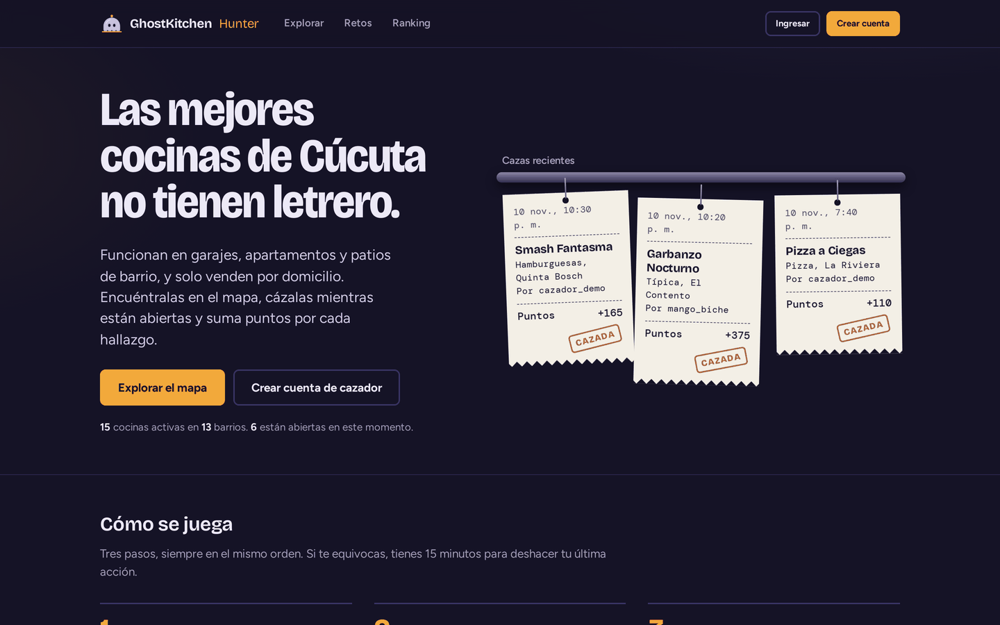](docs/capturas/01-portada.png)

> Las cocinas del catálogo son inventadas, pero los barrios y sus coordenadas son reales.

## Contenido

1. [Cómo ejecutarlo](#cómo-ejecutarlo)
2. [Recorrido por la aplicación](#recorrido-por-la-aplicación)
3. [Diseño propuesto](#diseño-propuesto)
4. [El patrón Command en detalle](#el-patrón-command-en-detalle)
5. [Decisiones de diseño](#decisiones-de-diseño)
6. [Arquitectura](#arquitectura)
7. [Qué se descartó y por qué](#qué-se-descartó-y-por-qué)
8. [Modelo de clases](#modelo-de-clases)
9. [Pruebas](#pruebas)
10. [Calidad y métricas](#calidad-y-métricas)
11. [Inconsistencias del enunciado y cómo las resolví](#inconsistencias-del-enunciado-y-cómo-las-resolví)
12. [Estructura del repositorio](#estructura-del-repositorio)
13. [ADR y otros documentos](#adr-y-otros-documentos)

## Cómo ejecutarlo

Necesitas JDK 17 o superior y Maven 3.9.

```bash
mvn spring-boot:run
```

Luego abre <http://localhost:8080>. La base de datos es H2 en memoria y al arrancar se carga un catálogo de demostración (16 cocinas, 6 cazadores, 36 cazas y 5 retos con fechas relativas al día de hoy, así siempre hay retos vigentes).

| Cuenta | Correo | Clave | Qué tiene de especial |
|---|---|---|---|
| Cazador | `cazador@ghostkitchen.co` | `Cazador2026` | Lleva dos días de racha y le falta una cocina para completar un reto |
| Administración | `admin@ghostkitchen.co` | `Admin2026` | Gestiona el catálogo de cocinas y los retos |

Para correr todas las pruebas y los controles de calidad (JaCoCo, PMD, CPD y ArchUnit):

```bash
mvn verify
```

Pruebas de mutación sobre el dominio (opcional): `mvn -Pmutacion test-compile org.pitest:pitest-maven:mutationCoverage`.

## Recorrido por la aplicación

1. **Portada.** Un riel de comandas muestra las tres cazas más recientes, cada una como un ticket de cocina con el sello CAZADA, y debajo están las reglas del juego y la tabla de puntos.
2. **Explorar.** Lista y mapa muestran lo mismo. Se puede buscar por nombre o barrio sin preocuparse por las tildes, filtrar por categoría o por las que están abiertas ahora y elegir entre cuatro órdenes. Con «Usar mi ubicación» las distancias se miden desde donde estás; si no, desde el Parque Santander.
3. **Ficha de la cocina.** Horario, canales de pedido, calificación y reseñas. Si está abierta y no la has cazado, el botón **Cazar esta cocina** imprime una comanda con el desglose de puntos.
4. **Deshacer.** Durante 15 minutos aparece arriba una barra con la última acción y su cuenta regresiva.
5. **Mi panel.** Puntos, nivel y lo que falta para el siguiente, nueve insignias (las que faltan dicen cómo ganarlas), retos inscritos, cazas y la actividad reciente con las acciones deshechas tachadas.
6. **Retos y ranking.** Retos vigentes con su avance y los próximos; ranking público donde los empates comparten puesto.
7. **Administración.** Registrar, editar, activar y desactivar cocinas (una cocina con cazas no se borra, se desactiva) y crear retos.

| | |
|---|---|
| [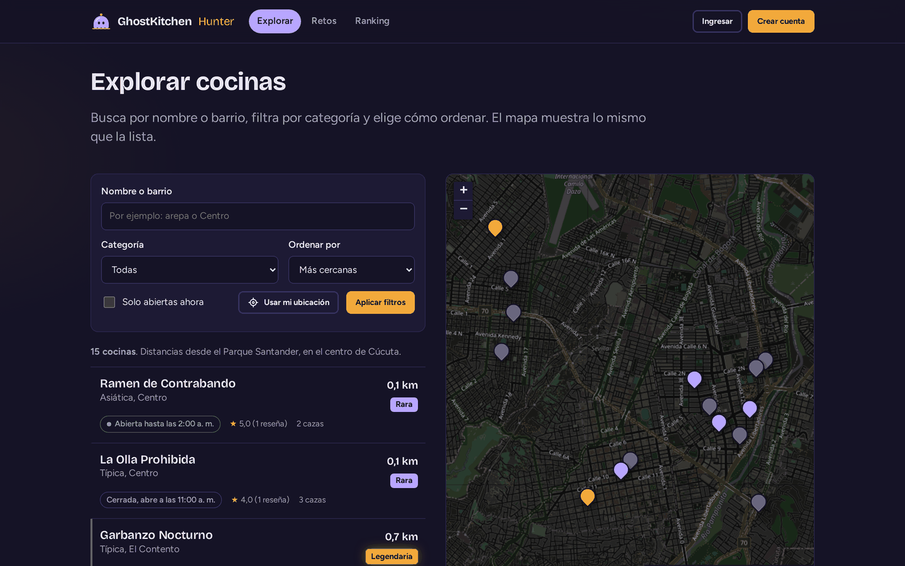](docs/capturas/02-explorar.png) | [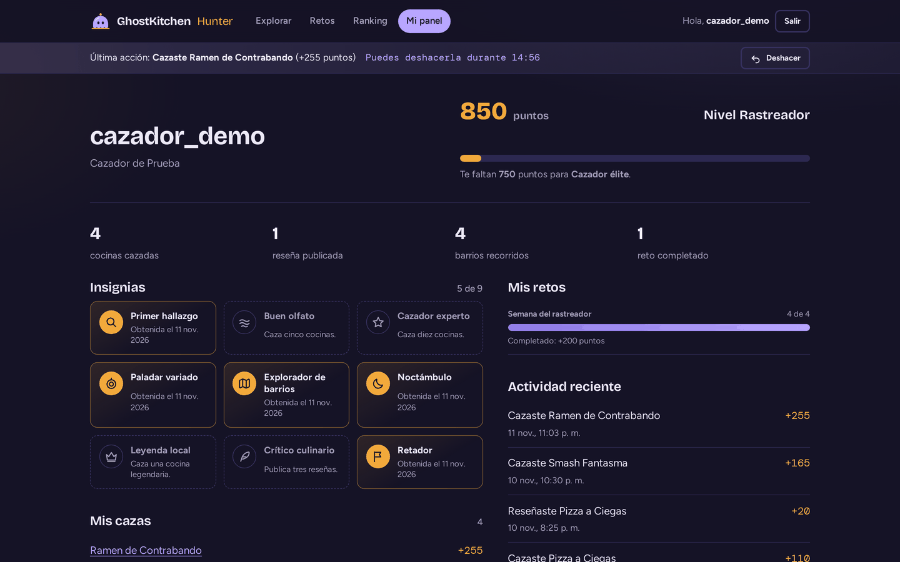](docs/capturas/05-panel.png) |
| [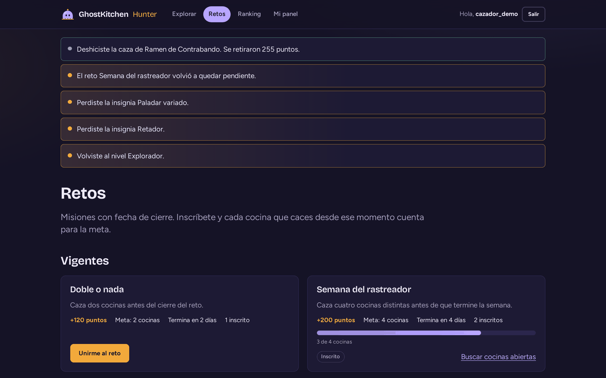](docs/capturas/06b-deshacer.png) | [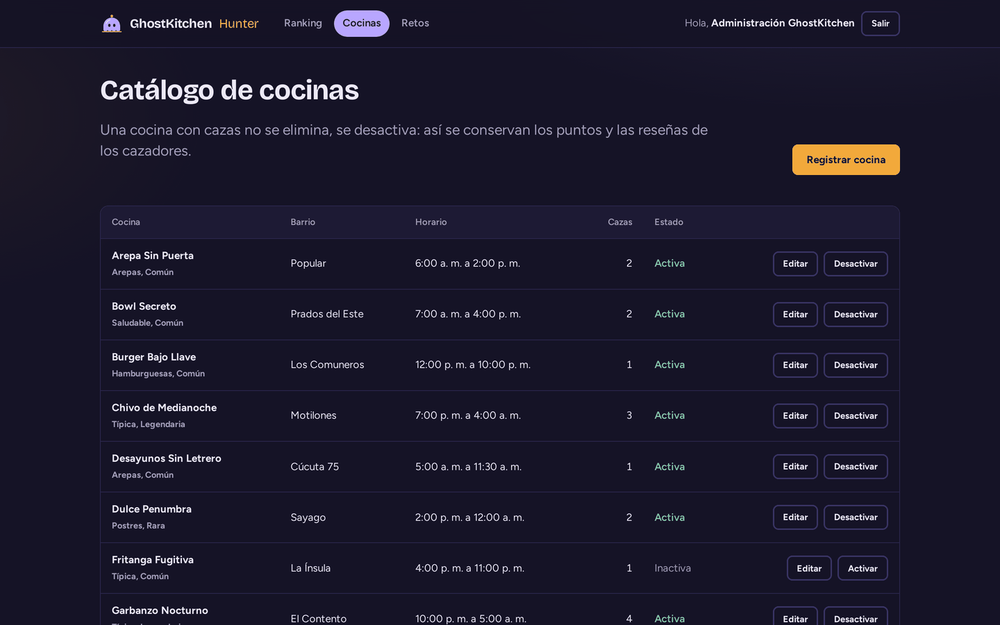](docs/capturas/09-admin-cocinas.png) |

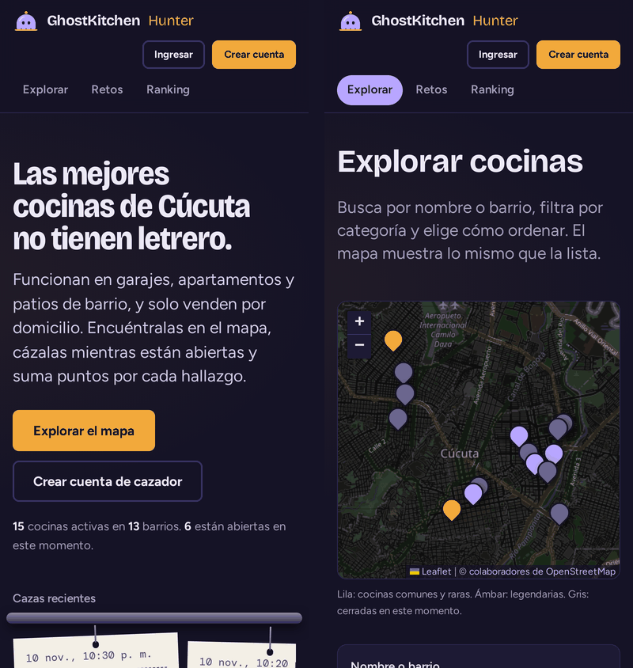

Todas las capturas son de la aplicación real: el flujo de calidad la arranca en GitHub Actions y la recorre con Playwright en cada envío ([`capturar-aplicacion.js`](https://github.com/NicolasSnchz/sanchez-ghostkitchen/blob/main/scripts/capturar-aplicacion.js)). Al hacer clic en una imagen se abre la página completa; las demás están en [`docs/capturas`](docs/capturas).

## Diseño propuesto

Antes de programar cada parte me hice tres preguntas: qué requisito del juego estoy resolviendo, qué es exactamente lo que varía en él (el punto de variabilidad) y si puedo justificar el patrón en una sola oración. Esa última es la prueba de explicabilidad de la guía de la unidad 12: si no me cabe en una oración por qué uso un patrón, probablemente no lo necesito. Por eso hay partes del proyecto sin ningún patrón, como el ranking o el registro de cuentas: son consultas y formularios donde no varía nada.

| # | Requisito | Qué varía | Patrón | Por qué este y no otro, en una oración | Código |
|---|---|---|---|---|---|
| 1 | El cazador puede deshacer su última caza, reseña o inscripción a un reto | La acción que se ejecuta y la forma de revertirla | **Command** | Convertir cada acción en un objeto con `ejecutar()` y `deshacer()` deja que un solo invocador las registre y revierta todas sin conocer ninguna, cosa que un método de servicio por acción no permite. | [línea 25](https://github.com/NicolasSnchz/sanchez-ghostkitchen/blob/main/src/main/java/co/edu/udes/ghostkitchen/aplicacion/acciones/HistorialAcciones.java#L25) |
| 2 | Deshacer funciona en una petición distinta a la que ejecutó la acción | Qué comando concreto hay que reconstruir desde el historial | **Factory Method** | El invocador pide «el comando que revierte esta entrada» sin depender de las tres clases concretas, que además son privadas de su paquete. | [línea 42](https://github.com/NicolasSnchz/sanchez-ghostkitchen/blob/main/src/main/java/co/edu/udes/ghostkitchen/aplicacion/acciones/FabricaComandosCazador.java#L42) |
| 3 | Una caza da puntos base por rareza más bonos que se combinan | Qué bonos aplican a cada caza y en qué orden se aplican | **Decorator** con **Template Method** | Los bonos se apilan y el multiplicador nocturno tiene que envolver a los fijos; Strategy elegiría uno solo y Chain of Responsibility cortaría la cadena en el primero que atienda. | [línea 10](https://github.com/NicolasSnchz/sanchez-ghostkitchen/blob/main/src/main/java/co/edu/udes/ghostkitchen/dominio/puntos/BonificacionPuntos.java#L10) |
| 4 | Después de cada acción se actualizan retos, insignias y nivel, y el cazador ve qué cambió | Quién reacciona a un cambio de progreso | **Observer** | Las reacciones se pueden agregar sin tocar los comandos, y el sujeto devuelve las novedades en la misma petición para mostrarlas. | [línea 24](https://github.com/NicolasSnchz/sanchez-ghostkitchen/blob/main/src/main/java/co/edu/udes/ghostkitchen/aplicacion/progreso/NotificadorProgreso.java#L24) |
| 5 | El explorador se ordena por cercanía, calificación, popularidad o novedad | El criterio de orden, elegido en cada petición | **Strategy** | Es el mismo listado con una regla de comparación que se cambia en tiempo de ejecución; un `switch` en el servicio crecería con cada criterio nuevo. | [línea 28](https://github.com/NicolasSnchz/sanchez-ghostkitchen/blob/main/src/main/java/co/edu/udes/ghostkitchen/aplicacion/catalogo/SelectorCriterioOrden.java#L28) |
| 6 | El administrador registra y edita cocinas con diez datos y reglas cruzadas | Qué combinación de datos llega y si es válida | **Builder** | Evita un constructor de diez parámetros y valida las reglas cruzadas (apertura distinta del cierre, al menos un canal de pedido, textos con tope) en un solo lugar, que se usa igual al crear con `build()` y al editar con `actualizar(Builder)`. | [línea 182](https://github.com/NicolasSnchz/sanchez-ghostkitchen/blob/main/src/main/java/co/edu/udes/ghostkitchen/dominio/modelo/CocinaFantasma.java#L182) |
| 7 | El panel del cazador junta puntos, nivel, insignias, retos, cazas y actividad | Cuántos servicios hay detrás del panel | **Facade** | El controlador depende de una sola clase en lugar de cinco servicios, y la forma de armar el panel queda en un lugar que se prueba sin la web. | [línea 38](https://github.com/NicolasSnchz/sanchez-ghostkitchen/blob/main/src/main/java/co/edu/udes/ghostkitchen/aplicacion/panel/PanelCazadorFacade.java#L38) |
| 8 | Al iniciar sesión, el cazador va a su panel y el administrador a su gestión | El destino según el rol | **Template Method** | Spring Security ya fija los pasos de la redirección; solo sobrescribo el paso que decide la URL. | [línea 18](https://github.com/NicolasSnchz/sanchez-ghostkitchen/blob/main/src/main/java/co/edu/udes/ghostkitchen/seguridad/RedireccionPorRol.java#L18) |

Hay al menos un patrón de cada categoría, como pide el protocolo: Builder y Factory Method (creacionales), Decorator y Facade (estructurales), y Command, Strategy, Observer y Template Method (de comportamiento). Cada uno resuelve un requisito distinto; ninguno está para completar la lista.

## El patrón Command en detalle

Es el patrón que me asignaron, así que quise que se notara en la interfaz y no solo en el código. Cada vez que el cazador caza, reseña o se une a un reto, aparece una barra con la última acción y un botón **Deshacer** con la cuenta regresiva de los 15 minutos.

[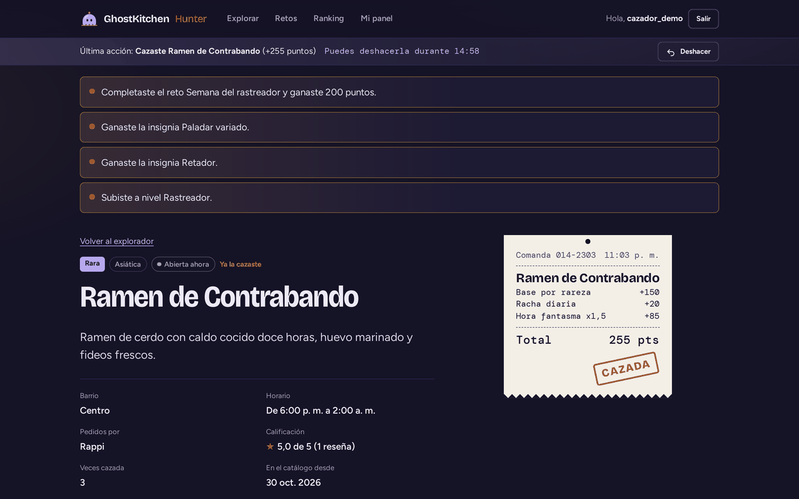](docs/capturas/04-cocina-cazada.png)

Los roles del patrón en el código:

| Rol | Clase | Qué hace |
|---|---|---|
| Comando | `Comando` ([línea 10](https://github.com/NicolasSnchz/sanchez-ghostkitchen/blob/main/src/main/java/co/edu/udes/ghostkitchen/aplicacion/acciones/Comando.java#L10)) | `ejecutar()` y `deshacer()`, más el tipo y el cazador |
| Comandos concretos | `DescubrirCocinaComando`, `PublicarResenaComando`, `UnirseARetoComando` | Guardan lo justo para ejecutar y revertir; son `final` y de paquete |
| Receptores | `RegistroCaza` ([línea 42](https://github.com/NicolasSnchz/sanchez-ghostkitchen/blob/main/src/main/java/co/edu/udes/ghostkitchen/aplicacion/acciones/RegistroCaza.java#L42)), `RegistroResenas`, `RegistroParticipaciones` | Hacen el trabajo real y saben deshacerlo |
| Invocador | `HistorialAcciones` | Ejecuta ([línea 48](https://github.com/NicolasSnchz/sanchez-ghostkitchen/blob/main/src/main/java/co/edu/udes/ghostkitchen/aplicacion/acciones/HistorialAcciones.java#L48)), guarda la acción y deshace la última ([línea 59](https://github.com/NicolasSnchz/sanchez-ghostkitchen/blob/main/src/main/java/co/edu/udes/ghostkitchen/aplicacion/acciones/HistorialAcciones.java#L59)) |
| Cliente | `CocinaControlador` ([línea 60](https://github.com/NicolasSnchz/sanchez-ghostkitchen/blob/main/src/main/java/co/edu/udes/ghostkitchen/presentacion/web/CocinaControlador.java#L60)) | Pide el comando a la fábrica y se lo entrega al invocador |

Tres decisiones que vale la pena explicar ([ADR-002](docs/adr/ADR-002-command-con-historial.md)):

- **El historial está en la base de datos.** Cada acción queda como una `AccionRegistrada` con su tipo, el cazador y el objetivo. Para deshacer, la fábrica reconstruye el comando adecuado ([línea 45](https://github.com/NicolasSnchz/sanchez-ghostkitchen/blob/main/src/main/java/co/edu/udes/ghostkitchen/aplicacion/acciones/FabricaComandosCazador.java#L45)). El `switch` es exhaustivo sobre el enum: si mañana agrego otro tipo de acción, el compilador me obliga a cubrirlo.
- **Se deshace como una pila y con ventana de tiempo.** Siempre la última acción vigente y solo durante 15 minutos ([línea 70](https://github.com/NicolasSnchz/sanchez-ghostkitchen/blob/main/src/main/java/co/edu/udes/ghostkitchen/dominio/modelo/AccionRegistrada.java#L70)). Así no se puede deshacer una caza mientras su reseña sigue en pie.
- **Deshacer deja todo coherente.** Como los puntos se calculan, no se acumulan ([ADR-004](docs/adr/ADR-004-puntos-derivados.md)), y los observadores vuelven a sincronizar retos, insignias y nivel después de deshacer, un reto completado vuelve a quedar pendiente si se deshace la caza que lo completó.

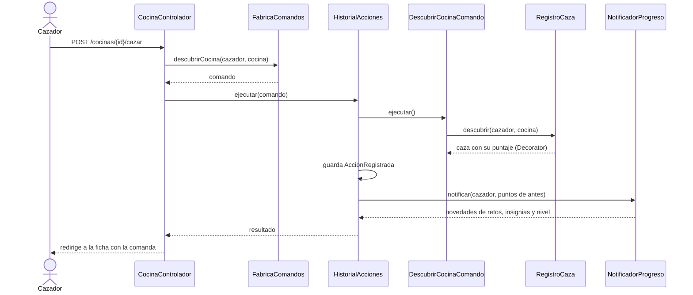

El diagrama completo, con la cadena de decoradores, está en [`secuencia-cazar.png`](docs/diagramas/secuencia-cazar.png), y el de deshacer en [`secuencia-deshacer.png`](docs/diagramas/secuencia-deshacer.png).

## Decisiones de diseño

Cada decisión tenía al menos dos caminos razonables. Dejo escrito qué elegí, qué gano y qué pago, para que se pueda discutir con argumentos y no con gustos. Las más grandes tienen además su ADR en [`docs/adr`](docs/adr).

### Decisión 1: capas simples y no hexagonal ([ADR-001](docs/adr/ADR-001-capas-y-mvc.md))

**Resumen del ADR-001.** La aplicación no se integra con ningún sistema externo (las cocinas reciben pedidos por Rappi, DiDi Food, WhatsApp o domicilio propio, y aquí solo se guarda cuáles usa cada una) y no hay ningún plan de cambiar de base de datos. Un puerto por repositorio serían ocho interfaces idénticas a las de Spring Data más ocho adaptadores que solo delegan: abstracción especulativa (YAGNI). Por eso los servicios dependen directamente de los repositorios y ArchUnit vigila los límites que sí existen.

- **Gano:** menos código, una estructura que cualquiera que conozca Spring entiende de una vez, y el único cambio previsible (avisar al cazador por otro medio) ya tiene su punto de extensión en el Observer.
- **Pago:** si llega una integración externa o un segundo motor de base de datos, el puerto habrá que introducirlo después. Es deuda aceptada a conciencia.

### Decisión 2: el historial de comandos vive en la base de datos, se deshace como pila y solo por 15 minutos ([ADR-002](docs/adr/ADR-002-command-con-historial.md))

En una aplicación web el objeto comando muere con la petición, así que el historial no puede ser una lista en memoria. Cada acción se guarda como `AccionRegistrada` con lo mínimo para revertirla y el comando se reconstruye al deshacer.

- **Gano:** el historial sobrevive al cierre de sesión, se muestra en el panel y deshacer siempre deja todo coherente, porque al ser una pila no se puede deshacer una caza mientras su reseña sigue en pie. La ventana de 15 minutos impide cazar de tarde y, horas después, deshacer y volver a cazar en la hora fantasma para ganar el x1,5.
- **Pago:** la reseña reconstruida no trae su texto (solo sirve para deshacer) y pasados 15 minutos la acción queda firme.

### Decisión 3: la fábrica usa un `switch` exhaustivo y no un mapa de creadores ([línea 45](https://github.com/NicolasSnchz/sanchez-ghostkitchen/blob/main/src/main/java/co/edu/udes/ghostkitchen/aplicacion/acciones/FabricaComandosCazador.java#L45))

La alternativa que se vio en clase es inyectar una lista de creadores y armar un mapa por tipo, para que agregar un comando no obligue a tocar la fábrica (abierto a extensión, cerrado a modificación). Lo pensé y elegí el `switch` sobre el enum `TipoAccion`.

- **Gano:** con tres tipos de acción, el compilador me obliga a cubrir cada valor del enum; si mañana agrego uno y olvido la fábrica, el proyecto no compila. Con el mapa ese olvido solo aparece en tiempo de ejecución, cuando alguien intenta deshacer.
- **Pago:** agregar una acción toca dos archivos (el enum y la fábrica), así que no cumplo el principio abierto/cerrado al pie de la letra.
- **Cuándo cambiaría:** con más de cinco o seis tipos de acción, o si las acciones vinieran de módulos que no controlo, el mapa de creadores pasaría a valer la pena.

### Decisión 4: el multiplicador nocturno envuelve a los bonos fijos ([ADR-005](docs/adr/ADR-005-decorator-para-los-bonos.md))

Con Decorator el orden de la cadena cambia el resultado. Una cocina legendaria cazada de primero, con cinco días de racha y en hora fantasma da (250 + 50 + 50) × 1,5 = **525** puntos con el orden que elegí; si el multiplicador envolviera solo la base, daría 250 × 1,5 + 50 + 50 = 475. Elegí premiar la noche sobre todo lo ganado, y lo dejé fijo en un solo lugar ([línea 40](https://github.com/NicolasSnchz/sanchez-ghostkitchen/blob/main/src/main/java/co/edu/udes/ghostkitchen/configuracion/ConfiguracionDominio.java#L40)).

- **Gano:** cada bono es una clase pequeña, el desglose de la comanda sale solo y el método `final` de la clase base impide que un bono olvide delegar.
- **Pago:** el orden es una regla de negocio que vive en la configuración. Para que no se pierda está comentado y la prueba PU-001 falla si alguien lo cambia.

### Decisión 5: Observer propio y no los eventos de Spring ([ADR-006](docs/adr/ADR-006-observer-propio.md))

Spring trae `ApplicationEventPublisher`, pero sus oyentes no devuelven nada y el cazador tiene que ver en la misma respuesta qué cambió («Subiste a nivel Explorador»). Además los retos deben actualizarse antes que el nivel, porque su recompensa cambia los puntos.

- **Gano:** cada observador devuelve sus novedades, el orden es explícito con `@Order` (ArchUnit lo exige) y todo corre en la transacción del comando: si algo falla, no queda una caza sin su progreso.
- **Pago:** los observadores corren en el mismo hilo; uno lento haría lenta la caza.

### Decisión 6: el total de puntos se deriva, no se acumula ([ADR-004](docs/adr/ADR-004-puntos-derivados.md))

Cada caza guarda los puntos que ganó en su momento, porque la racha, el bono de primer cazador y la hora no se pueden reconstruir después. Pero el total del cazador no se guarda: lo calcula `PuntosCazador.total()` y lo usan por igual el panel y el ranking.

- **Gano:** deshacer cualquier acción deja el total correcto sin restar nada a mano, y el panel y el ranking nunca muestran cifras distintas (`DatosDemoIT` lo comprueba).
- **Pago:** el ranking hace consultas de agregación en vez de leer un campo.

### Decisión 7: anotaciones de JPA en el dominio, pero nada de Spring ([ADR-003](docs/adr/ADR-003-anotaciones-jpa-en-el-dominio.md))

El ejemplo de la unidad 12 deja el dominio libre de Spring y de JPA. Separar aquí el modelo de dominio del modelo JPA duplicaría unas veinte clases y sus mapeadores para protegerme de un cambio de base de datos que no está previsto.

- **Gano:** un solo lugar para cada regla, y las pruebas del dominio corren sin base de datos ni Spring.
- **Pago:** el dominio queda atado a JPA y la regla ARQ-02 es más débil que la del ejemplo (prohíbe Spring, no JPA). Está escrito en el ADR para que no parezca un olvido.

### Decisión 8: las estrategias de orden se registran solas ([línea 20](https://github.com/NicolasSnchz/sanchez-ghostkitchen/blob/main/src/main/java/co/edu/udes/ghostkitchen/aplicacion/catalogo/SelectorCriterioOrden.java#L20))

Aquí sí uso el mapa que descarté en la decisión 3, y la diferencia es a propósito. `SelectorCriterioOrden` recibe de Spring la lista de criterios y arma un `EnumMap` por tipo; si dos criterios dicen ser del mismo tipo, la aplicación no arranca.

- **Gano:** agregar un orden nuevo es escribir una clase y registrarla como bean; el selector, el servicio y el controlador no cambian. A diferencia de los comandos, los criterios no tienen estado ni receptores, así que no hay nada que el compilador me ayude a cuidar.
- **Pago:** si falta un criterio para un valor del enum, el error aparece al pedir ese orden y no al compilar. Para no depender de la suerte, `VistasIT` pide el explorador con cada valor de `TipoOrden` usando los criterios reales de Spring.

## Arquitectura

La arquitectura resultante son **capas con MVC de Spring Boot**, por las razones de la [Decisión 1](#decisión-1-capas-simples-y-no-hexagonal-adr-001) y el [ADR-001](docs/adr/ADR-001-capas-y-mvc.md).

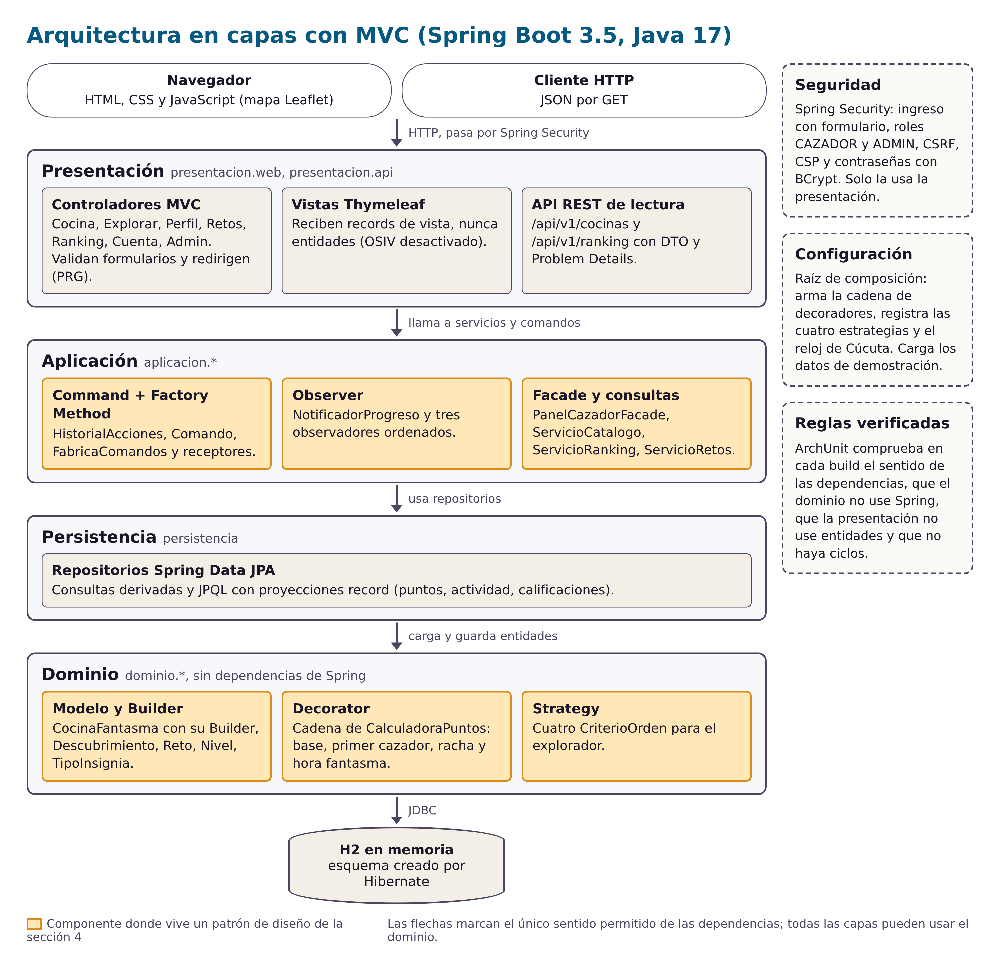

- **Presentación** (`presentacion.web` y `presentacion.api`): controladores delgados, vistas Thymeleaf y una API REST de solo lectura. Las vistas reciben records, nunca entidades, y por eso `spring.jpa.open-in-view` está apagado ([línea 8](https://github.com/NicolasSnchz/sanchez-ghostkitchen/blob/main/src/main/resources/application.properties#L8)).
- **Aplicación** (`aplicacion.*`): casos de uso, el invocador de comandos, los observadores y la fachada del panel.
- **Persistencia** (`persistencia`): repositorios Spring Data con consultas JPQL que devuelven proyecciones record.
- **Dominio** (`dominio.*`): entidades con sus reglas, el cálculo de puntos y las estrategias de orden. No depende de Spring ([ADR-003](docs/adr/ADR-003-anotaciones-jpa-en-el-dominio.md)).
- **Seguridad** y **configuración** son transversales. `ConfiguracionDominio` es la raíz de composición: ahí se arma la cadena de decoradores y se registran las estrategias ([línea 39](https://github.com/NicolasSnchz/sanchez-ghostkitchen/blob/main/src/main/java/co/edu/udes/ghostkitchen/configuracion/ConfiguracionDominio.java#L39)).

Estas reglas no son de palabra: [`ArquitecturaTest`](https://github.com/NicolasSnchz/sanchez-ghostkitchen/blob/main/src/test/java/co/edu/udes/ghostkitchen/arquitectura/ArquitecturaTest.java) las comprueba con ArchUnit en cada build, con nueve reglas numeradas de ARQ-01 a ARQ-09: sentido de las capas, dominio sin Spring, presentación sin entidades, sin ciclos, comandos encapsulados, observadores con orden explícito, controladores y repositorios en su capa, e inyección por constructor.

### Paquetes y acoplamiento

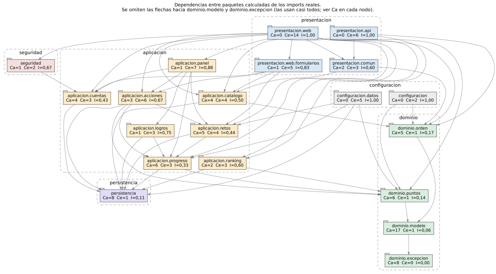

El diagrama y las métricas salen de los `import` reales con [`scripts/acoplamiento-paquetes.py`](scripts/acoplamiento-paquetes.py), no los dibujé a mano. Son 74 dependencias entre 20 paquetes y todas bajan de capa. Además, ninguna va de un paquete más estable a uno menos estable (principio de dependencias estables): los controladores tienen inestabilidad 1,00 y `dominio.modelo` 0,06. El único punto delicado es que `dominio.modelo` queda en la llamada zona de dolor (concreto y muy usado); en [`docs/acoplamiento-paquetes.md`](docs/acoplamiento-paquetes.md) explico por qué lo acepto y qué lo protege.

### La prueba de que ArchUnit sí detiene el build

Una regla de arquitectura que nunca ha fallado no demuestra mucho, así que la rompí a propósito. En la rama [`demo/violacion-arquitectura`](https://github.com/NicolasSnchz/sanchez-ghostkitchen/tree/demo/violacion-arquitectura) el commit *«violación intencional»* hace que `PortadaControlador` use `RepositorioCocinas` directamente, saltándose la capa de aplicación, que es el atajo más tentador cuando uno tiene afán. GitHub Actions corre las pruebas en esa rama y el build falla en `ArquitecturaTest` por la regla ARQ-01. En `main` está el mismo commit seguido de su revert, y ahí el build vuelve a verde.

El historial queda a la vista en GitHub Actions: [ejecuciones en la rama de la violación](https://github.com/NicolasSnchz/sanchez-ghostkitchen/actions/workflows/ci.yml?query=branch%3Ademo%2Fviolacion-arquitectura) y [ejecuciones en `main`](https://github.com/NicolasSnchz/sanchez-ghostkitchen/actions/workflows/ci.yml?query=branch%3Amain). El flujo [`historial.yml`](.github/workflows/historial.yml) guarda además el registro del build fallido y capturas de esas páginas.

## Qué se descartó y por qué

Saber cuándo no aplicar un patrón también cuenta. Ninguno de estos descartes es definitivo: es la decisión vigente hoy, y para cada uno dejo la señal que me haría reconsiderarla. Los anclo en los principios de la guía de la unidad 12: **YAGNI** (no construir lo que nadie ha pedido), **KISS** (la solución más simple que funcione), la **regla de tres** (abstraer cuando el caso se repite por tercera vez, no antes) y la **prueba de explicabilidad** (si no puedo justificar el patrón en una oración, sobra).

| Qué consideré | Por qué lo descarté | Señal que me haría reconsiderarlo |
|---|---|---|
| **Arquitectura hexagonal**, con un puerto y un adaptador por repositorio | **YAGNI.** No hay sistemas externos ni planes de cambiar de base de datos; serían ocho interfaces copiadas de Spring Data ([ADR-001](docs/adr/ADR-001-capas-y-mvc.md)). | La primera integración real con un sistema externo (por ejemplo, leer pedidos de Rappi) o un segundo motor de base de datos. |
| **Chain of Responsibility para validar una caza** ([línea 60](https://github.com/NicolasSnchz/sanchez-ghostkitchen/blob/main/src/main/java/co/edu/udes/ghostkitchen/aplicacion/acciones/RegistroCaza.java#L60)) | **Prueba de explicabilidad y KISS.** Son cuatro reglas fijas (cocina activa, no cazada antes por ti, abierta ahora y máximo cinco cazas al día) que se leen de arriba abajo en unas doce líneas de cláusulas de guarda. La única oración que encontré para justificar la cadena fue «por si cambian las reglas», que es especulación. | Que el administrador necesite activar o desactivar reglas, o que las reglas cambien según la categoría de la cocina. |
| **State para el nivel del cazador** | **KISS.** El nivel se deriva de los puntos y no cambia lo que el cazador puede hacer; un enum con `paraPuntos()` basta ([línea 22](https://github.com/NicolasSnchz/sanchez-ghostkitchen/blob/main/src/main/java/co/edu/udes/ghostkitchen/dominio/modelo/Nivel.java#L22)). State tiene sentido cuando el comportamiento cambia con el estado. | Que un nivel desbloquee acciones distintas, por ejemplo que solo una Leyenda pueda proponer cocinas nuevas. |
| **Memento para deshacer** | **KISS.** Habría que copiar cazas, reseñas, retos e insignias en cada acción. Cada comando ya sabe revertir exactamente lo que hizo y los puntos se recalculan solos ([ADR-002](docs/adr/ADR-002-command-con-historial.md)). | Una acción sin una forma natural de revertirse, como editar una reseña, donde hay que guardar el texto anterior. |
| **Abstract Factory de comandos por rol** | **Regla de tres.** Solo existe una familia de comandos, la del cazador: las acciones del administrador no se deshacen. Con una familia, `FabricaComandos` y su implementación alcanzan. | Que las acciones del administrador también se puedan deshacer (segunda familia). Con una tercera, la fábrica abstracta ya se justificaría. |
| **Una excepción por cada regla de negocio** | **KISS.** Hay quince reglas y todas se manejan igual: un mensaje para el usuario y volver a la página anterior. Uso una sola `ReglaNegocioException` con un código que apunta a `messages.properties`, y quince clases no cambiarían nada de ese manejo. | Que alguna regla necesite un tratamiento distinto, como un código HTTP propio en la API o un reintento automático. |
| **Singleton escrito a mano** | **Prueba de explicabilidad.** Spring ya crea una instancia por bean; un Singleton estático solo me impediría pasar dobles de prueba. | Una clase que tenga que vivir fuera del contenedor de Spring, cosa que hoy no pasa. |
| **Rehacer (redo)** | **YAGNI.** Nadie lo pidió y abre casos raros, como rehacer una caza cuando la cocina ya cerró. | Que los usuarios lo pidan de forma explícita. |
| **Eventos asíncronos para los observadores** | **KISS.** Los tres observadores trabajan sobre la misma base y en milisegundos; volverlos asíncronos rompería la transacción y no podría mostrar las novedades en la misma respuesta ([ADR-006](docs/adr/ADR-006-observer-propio.md)). | Un observador con entrada y salida externa, como enviar un correo al completar un reto. Ese iría con `@TransactionalEventListener` y asíncrono. |
| **CQRS o un modelo de lectura aparte** | **KISS.** Las lecturas son consultas JPQL que devuelven records y caben en el mismo modelo. | Que el ranking o el explorador se vuelvan lentos con datos reales y haya que precalcularlos. |

## Modelo de clases

El modelo completo tiene más de cuarenta clases, así que lo partí en vistas. Las clases con **[P]** participan en un patrón (ámbar: Builder, Command y Decorator; lila: Factory Method y Strategy; verde: Observer y Facade). Las fuentes Mermaid y las versiones SVG están en [`docs/diagramas`](docs/diagramas).

| Vista | Qué muestra |
|---|---|
| [Usuarios y catálogo](docs/diagramas/clases-catalogo.svg) | Herencia de `Usuario`, composición con `Ubicacion` y el Builder |
| [Cazas, reseñas, retos y logros](docs/diagramas/clases-cazas.svg) | Asociaciones con multiplicidad, composición de la reseña y agregación del reto |
| [Command y Factory Method](docs/diagramas/clases-command.svg) | Cliente, invocador, comandos, receptores y fábrica |
| [Observer](docs/diagramas/clases-observer.svg) | Sujeto y observadores ordenados |
| [Decorator](docs/diagramas/clases-decorator.svg) | Cadena de cálculo de puntos con Template Method |
| [Strategy](docs/diagramas/clases-strategy.svg) | Criterios de orden y su selector |
| [Facade](docs/diagramas/clases-facade.svg) | El panel del cazador |

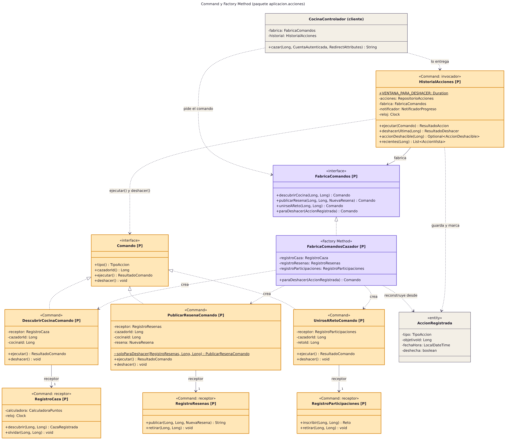

## Pruebas

Las pruebas salen de los casos de uso y de los patrones del protocolo, y cada una lleva su identificador en el `@DisplayName` para poder rastrearla ([matriz de trazabilidad](docs/trazabilidad.md)).

| Tipo | Dónde | Qué cubren |
|---|---|---|
| Unitarias (`*Test`, Surefire) | `src/test/java/.../dominio`, `aplicacion`, `presentacion` | 23 escenarios PU: reglas del dominio sin Spring, el invocador y la fábrica de comandos, observadores, estrategias y la redirección segura |
| Integración (`*IT`, Failsafe) | `src/test/java/.../integracion` y `configuracion/datos` | 11 escenarios PI con MockMvc, Spring Security y H2: cazar y deshacer de punta a punta, retos, API REST, registro, administración, consultas JPQL, el renderizado de todas las vistas y la validez de los datos de demostración |
| Arquitectura | `ArquitecturaTest` | 10 reglas de ArchUnit sobre capas, ciclos y patrones |

Usé cada tipo de doble de prueba donde tenía sentido, no por cumplir:

- **Stub:** repositorios que devuelven datos fijos, por ejemplo cinco cazas en el día para probar el límite diario (PU-013).
- **Mock:** cuando lo que importa es la colaboración y su orden, como en el invocador del Command (PU-014) o el notificador del Observer (PU-018).
- **Spy:** para comprobar que un decorador delega en el que envuelve sin perder su comportamiento real (PU-002).
- **Fake:** un `Clock.fixed` en lugar del reloj real, para que la ventana de 15 minutos se pruebe igual a cualquier hora (PU-016).
- **Dummy:** objetos que el constructor exige pero que la prueba verifica que nunca se usan, como la calculadora cuando la cocina está cerrada (PU-012).

## Calidad y métricas

Los umbrales se fijaron antes de implementar (sección 7 del protocolo) y el build falla si no se cumplen:

| Métrica | Herramienta | Umbral |
|---|---|---|
| Cobertura de líneas y ramas del proyecto | JaCoCo y SonarQube | ≥ 70 % |
| Cobertura de líneas del dominio | JaCoCo | ≥ 90 % |
| Complejidad ciclomática por método | PMD y SonarQube | ≤ 10 |
| Complejidad cognitiva por método | PMD y SonarQube | ≤ 15 |
| Deuda técnica | SonarQube | ≤ 30 min por KLOC y mantenibilidad A |
| Duplicación | CPD y SonarQube | ≤ 3 % |
| Bugs y vulnerabilidades | SonarQube | 0 |
| Violaciones de arquitectura | ArchUnit | 0 |

El flujo [Calidad con SonarQube y capturas](.github/workflows/calidad.yml) levanta SonarQube Community en un contenedor de GitHub Actions, crea una puerta de calidad con estos umbrales, analiza el proyecto y guarda las métricas medidas como artefacto.

### Decisiones de calidad

1. **Entorno: SonarQube Community en Docker, dentro de GitHub Actions.** Es la herramienta que usamos en la unidad 10 y así cada análisis arranca de cero, con la misma versión y la misma configuración, sin depender de un servidor que alguien tenga que mantener encendido. El precio es que el historial de SonarQube no se conserva entre ejecuciones; por eso cada ejecución guarda las métricas medidas y las capturas como evidencia.
2. **Perfil de calidad propio.** El perfil «GhostKitchen» hereda de *Sonar way* y activa `java:S1541` (complejidad ciclomática máxima 10 por método) y ajusta `java:S3776` (complejidad cognitiva máxima 15) ([`preparar-sonarqube.sh`](https://github.com/NicolasSnchz/sanchez-ghostkitchen/blob/main/scripts/preparar-sonarqube.sh)). Son los mismos umbrales que PMD revisa en el build local, para que las dos herramientas no se contradigan.
3. **Exclusiones, pocas y explicadas.** Fuera del análisis quedan solo las fuentes tipográficas (`static/fuentes`), que son binarios de terceros. Fuera de la cobertura quedan la clase `main`, el cargador de datos de demostración (que tiene su propia prueba, PI-011, pero no aporta lógica del juego) y el JavaScript del navegador, que no corre en las pruebas de Java. No excluí nada para subir el número.
4. **Métrica de cobertura: líneas y ramas, y más exigente en el dominio.** El 70 % global se mide con las pruebas unitarias y de integración juntas, porque los controladores solo se ejercitan de verdad con MockMvc. Al dominio le exijo 90 % de líneas porque ahí están las reglas del juego.
5. **Criterio de pruebas.** Cada caso de uso tiene al menos una prueba que lo recorre y cada patrón una prueba de su colaboración (ver la [matriz de trazabilidad](docs/trazabilidad.md)). Los dobles se eligen por lo que se quiere verificar, no por cumplir.
6. **Una puerta de calidad realista.** La primera versión de la puerta exigía cero *code smells*, y la quité: cualquier detalle menor rompería el build y la tentación sería marcarlo como falso positivo. La puerta exige en cambio lo que sí se comprometió en el protocolo: cobertura ≥ 70 %, duplicación ≤ 3 %, deuda ≤ 30 min por KLOC, mantenibilidad, confiabilidad y seguridad en A.

### Code smells del plan de refactorización y dónde quedaron

En la sección 7.2 del protocolo anticipé siete *code smells* antes de programar. Esta tabla dice qué técnica del catálogo de Fowler usé con cada uno, dónde se ve en el código y qué control evita que vuelva a aparecer:

| Code smell | Técnica de Fowler | Dónde quedó resuelto | Qué lo vigila |
|---|---|---|---|
| Long Method | Extract Method | `RegistroCaza.descubrir()` delega en `validar()` y `diasDeRacha()` ([línea 42](https://github.com/NicolasSnchz/sanchez-ghostkitchen/blob/main/src/main/java/co/edu/udes/ghostkitchen/aplicacion/acciones/RegistroCaza.java#L42)) | PMD: complejidad ciclomática ≤ 10 y cognitiva ≤ 15; SonarQube: `java:S1541` y `java:S3776` |
| Switch Statements | Replace Conditional with Polymorphism | Los bonos son decoradores y los órdenes son estrategias; no hay un `if` por bono ni por orden ([línea 10](https://github.com/NicolasSnchz/sanchez-ghostkitchen/blob/main/src/main/java/co/edu/udes/ghostkitchen/dominio/puntos/BonificacionPuntos.java#L10)) | Las mismas reglas de complejidad |
| Long Parameter List | Introduce Parameter Object y Builder | `CocinaFantasma.Builder` y el record `DatosCocina` ([línea 11](https://github.com/NicolasSnchz/sanchez-ghostkitchen/blob/main/src/main/java/co/edu/udes/ghostkitchen/aplicacion/catalogo/DatosCocina.java#L11)) | PMD: `ExcessiveParameterList` |
| Data Clumps | Introduce Parameter Object | Latitud y longitud viajan como `Coordenada` y con el barrio como `Ubicacion`; la distancia se calcula en un solo lugar ([línea 23](https://github.com/NicolasSnchz/sanchez-ghostkitchen/blob/main/src/main/java/co/edu/udes/ghostkitchen/dominio/modelo/Coordenada.java#L23)) | CPD y la duplicación de SonarQube (≤ 3 %) |
| Duplicated Code | Extract Class | La web y la API leen los filtros con la misma clase, `ParametrosBusqueda` ([línea 25](https://github.com/NicolasSnchz/sanchez-ghostkitchen/blob/main/src/main/java/co/edu/udes/ghostkitchen/presentacion/comun/ParametrosBusqueda.java#L25)) | CPD hace fallar el build |
| Feature Envy | Move Method | En vez de que el ranking calcule los puntos con datos de reseñas y retos, la fórmula vive en el dominio, `PuntosCazador.total()`, y la usan el ranking y el panel ([línea 14](https://github.com/NicolasSnchz/sanchez-ghostkitchen/blob/main/src/main/java/co/edu/udes/ghostkitchen/dominio/puntos/PuntosCazador.java#L14)) | `DatosDemoIT` compara ranking y panel |
| Large Class | Extract Class (si hace falta) | `CocinaControlador` tiene hoy tres acciones y 83 líneas, así que no lo partí: hacerlo ahora sería anticiparme (YAGNI). Si crece, las reseñas se van a su propio controlador. | PMD: `GodClass` |

## Inconsistencias del enunciado y cómo las resolví

Al leer el protocolo con la rúbrica al lado encontré algunos puntos que se contradicen o que no se pueden cumplir tal como están escritos. No los ignoré; esto es lo que hice con cada uno:

| Qué dice el enunciado | El problema | Cómo lo resolví |
|---|---|---|
| La plantilla de la sección 2 trae tres fichas de caso de uso | El requisito mínimo de la misma sección pide entre 8 y 10 casos de uso | Hice una ficha por cada uno de los 10 casos de uso. |
| La tabla de pruebas unitarias de la sección 6 trae cinco filas | El requisito mínimo pide 10 escenarios | Documenté 23 escenarios unitarios (PU-001 a PU-023) y 11 de integración (PI-001 a PI-011), todos con su identificador en el `@DisplayName`. |
| La métrica de deuda técnica es «≤ 30 min / KLOC» medida con SonarQube | SonarQube no tiene esa métrica: reporta la deuda en minutos (`sqale_index`) y como porcentaje del costo de desarrollo (`sqale_debt_ratio`) | Con el costo por defecto de SonarQube (30 min por línea), 30 min por KLOC equivale a un `sqale_debt_ratio` de 0,1 %. Esa es la condición que puse en la puerta de calidad, y además el flujo calcula y guarda el valor en minutos por KLOC. |
| El ejemplo de la unidad 12 deja el dominio sin Spring y sin JPA | Cumplirlo duplicaría el modelo para protegerlo de un cambio que no está previsto | El dominio no tiene Spring (regla ARQ-02) pero sí anotaciones JPA, y la decisión está justificada en el [ADR-003](docs/adr/ADR-003-anotaciones-jpa-en-el-dominio.md) y en la Decisión 7. |
| La unidad 12 pide ver en el historial de Actions un build fallido por una violación intencional y el build en verde tras el revert | GitHub Actions solo construye el último commit de cada envío, y el proyecto se sube en un solo envío | La violación vive en la rama `demo/violacion-arquitectura`, que se construye por separado, y `main` tiene el mismo commit seguido de su revert. Así el historial muestra los dos builds. |
| La sección 4 pide al menos un patrón por categoría | No dice cuántos como máximo, y la rúbrica premia que no haya sobreingeniería | Usé ocho, cada uno atado a un requisito con su prueba de explicabilidad (ver [Diseño propuesto](#diseño-propuesto)), y documenté diez alternativas descartadas. |

## Estructura del repositorio

```text
src/main/java/co/edu/udes/ghostkitchen
├── dominio          modelo, puntos (Decorator), orden (Strategy), excepciones
├── persistencia     repositorios Spring Data y proyecciones
├── aplicacion       acciones (Command), progreso (Observer), retos, logros, catalogo, panel (Facade), ranking, cuentas
├── presentacion     web (controladores y formularios), api (REST), comun
├── seguridad        Spring Security y la cuenta autenticada
└── configuracion    raíz de composición y datos de demostración
src/main/resources   plantillas Thymeleaf, CSS, JS, fuentes, messages.properties, datos-demo.json
src/test/java        pruebas unitarias (*Test), de integración (*IT) y de arquitectura
config/pmd           reglas de complejidad y duplicación que hacen fallar el build
docs                 ADR, diagramas, acoplamiento entre paquetes, trazabilidad y el protocolo del previo final
scripts              SonarQube, capturas con Playwright, resumen de pruebas y cálculo de acoplamiento
```

## ADR y otros documentos

- [ADR-001 Capas simples con MVC, sin puertos hexagonales](docs/adr/ADR-001-capas-y-mvc.md)
- [ADR-002 Command con historial persistido, deshacer en pila y ventana de 15 minutos](docs/adr/ADR-002-command-con-historial.md)
- [ADR-003 Anotaciones de JPA en el dominio, sin Spring](docs/adr/ADR-003-anotaciones-jpa-en-el-dominio.md)
- [ADR-004 El total de puntos y el nivel se derivan](docs/adr/ADR-004-puntos-derivados.md)
- [ADR-005 Decorator con Template Method para los bonos](docs/adr/ADR-005-decorator-para-los-bonos.md)
- [ADR-006 Observer propio y ordenado](docs/adr/ADR-006-observer-propio.md)
- [Matriz de trazabilidad](docs/trazabilidad.md): caso de uso, patrón, clases y pruebas
- [Acoplamiento entre paquetes](docs/acoplamiento-paquetes.md): Ca, Ce, inestabilidad y distancia de cada paquete
- [Protocolo del previo final en PDF](docs/protocolo/Protocolo_PrevioFinal_GhostKitchenHunter.pdf) y [en Word](docs/protocolo/Protocolo_PrevioFinal_GhostKitchenHunter.docx)

### Créditos

Mapa con [Leaflet](https://leafletjs.com) y teselas de [OpenStreetMap](https://www.openstreetmap.org/copyright), oscurecidas con un filtro CSS. Fuentes Bricolage Grotesque, Figtree y DM Mono bajo licencia SIL Open Font (las licencias están en `src/main/resources/static/fuentes`).
