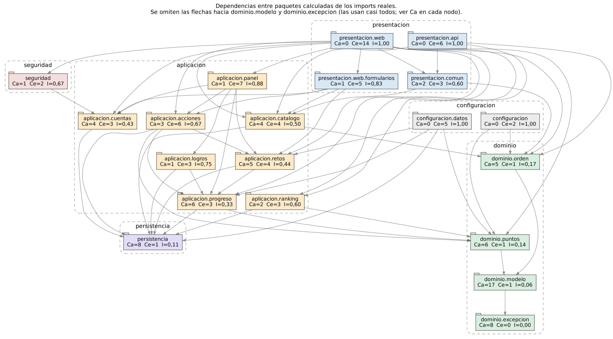

# Acoplamiento entre paquetes

Estas métricas salen de los `import` reales del código, no de una estimación. Las calcula [`scripts/acoplamiento-paquetes.py`](../scripts/acoplamiento-paquetes.py) con las definiciones de Robert C. Martin en la variante de JDepend, que cuenta paquetes y no clases:

- **Ca** (acoplamiento aferente): cuántos paquetes dependen de este.
- **Ce** (acoplamiento eferente): de cuántos paquetes depende este.
- **I = Ce / (Ca + Ce)**: inestabilidad. 0 es un paquete del que todos dependen y que no depende de nadie; 1 es lo contrario.
- **A**: proporción de interfaces y clases abstractas entre los tipos del paquete.
- **D = |A + I − 1|**: distancia a la secuencia principal.

Para regenerar la tabla y el diagrama:

```bash
python3 scripts/acoplamiento-paquetes.py
python3 scripts/acoplamiento-paquetes.py --dot > docs/diagramas/paquetes.dot && dot -Tsvg docs/diagramas/paquetes.dot -o docs/diagramas/paquetes.svg
```

## Resultados

| Paquete | Tipos | Ca | Ce | I | A | D |
|---|---:|---:|---:|---:|---:|---:|
| `aplicacion.acciones` | 16 | 3 | 6 | 0,67 | 0,12 | 0,21 |
| `aplicacion.catalogo` | 12 | 4 | 4 | 0,50 | 0,00 | 0,50 |
| `aplicacion.cuentas` | 3 | 4 | 3 | 0,43 | 0,00 | 0,57 |
| `aplicacion.logros` | 4 | 1 | 3 | 0,75 | 0,00 | 0,25 |
| `aplicacion.panel` | 2 | 1 | 7 | 0,88 | 0,00 | 0,12 |
| `aplicacion.progreso` | 7 | 6 | 3 | 0,33 | 0,14 | 0,52 |
| `aplicacion.ranking` | 2 | 2 | 3 | 0,60 | 0,00 | 0,40 |
| `aplicacion.retos` | 7 | 5 | 4 | 0,44 | 0,00 | 0,56 |
| `configuracion` | 1 | 0 | 2 | 1,00 | 0,00 | 0,00 |
| `configuracion.datos` | 2 | 0 | 5 | 1,00 | 0,00 | 0,00 |
| `dominio.excepcion` | 2 | 8 | 0 | 0,00 | 0,00 | 1,00 |
| `dominio.modelo` | 23 | 17 | 1 | 0,06 | 0,04 | 0,90 |
| `dominio.orden` | 7 | 5 | 1 | 0,17 | 0,14 | 0,69 |
| `dominio.puntos` | 11 | 6 | 1 | 0,14 | 0,18 | 0,68 |
| `persistencia` | 13 | 8 | 1 | 0,11 | 0,62 | 0,27 |
| `presentacion.api` | 6 | 0 | 6 | 1,00 | 0,00 | 0,00 |
| `presentacion.comun` | 1 | 2 | 3 | 0,60 | 0,00 | 0,40 |
| `presentacion.web` | 17 | 0 | 14 | 1,00 | 0,00 | 0,00 |
| `presentacion.web.formularios` | 4 | 1 | 5 | 0,83 | 0,00 | 0,17 |
| `seguridad` | 4 | 1 | 2 | 0,67 | 0,00 | 0,33 |



## Lectura

**No hay ciclos.** El grafo tiene 74 dependencias entre 20 paquetes y todas bajan: presentación, luego seguridad y configuración, luego aplicación, persistencia y dominio. ArchUnit lo exige en cada build (ARQ-04), tanto entre capas como entre los módulos de `aplicacion`.

**Se cumple el principio de dependencias estables.** Revisé las 74 aristas una por una con el script y en ninguna un paquete depende de otro más inestable que él. Por ejemplo, `aplicacion.retos` (I = 0,44) depende de `aplicacion.progreso` (I = 0,33), y no al revés.

**Los paquetes más inestables son los que deben serlo.** `presentacion.web` tiene Ce = 14 e I = 1,00: depende de casi todo y nadie depende de él, que es justo lo que se espera de los controladores. Para que ese Ce no creciera más, el panel del cazador entra por una sola fachada (`aplicacion.panel`) en lugar de que `PerfilControlador` hable con cinco servicios.

**Los puntos de variación están donde hay abstracciones.** Los cuatro paquetes con A > 0 fuera de persistencia son justo los de los patrones de comportamiento: `dominio.puntos` (Decorator, A = 0,18), `dominio.orden` (Strategy, A = 0,14), `aplicacion.progreso` (Observer, A = 0,14) y `aplicacion.acciones` (Command y Factory Method, A = 0,12). `persistencia` tiene A = 0,62 porque los repositorios de Spring Data son interfaces.

**`dominio.modelo` está en la zona de dolor (D = 0,90), y lo acepto.** Es concreto y 17 paquetes dependen de él, así que un cambio ahí se propaga. Volverlo abstracto, con interfaces para cada entidad, sería una abstracción especulativa sin ningún caso de uso que la pida (YAGNI). Lo que lo protege es otra cosa: el dominio no depende de nadie más que de `dominio.excepcion` (Ce = 1), tiene las reglas del juego encapsuladas en métodos y la puerta de JaCoCo exige al menos 90 % de cobertura de líneas en `dominio.*`. `dominio.excepcion` (D = 1,00) es el mismo caso, más extremo y más inofensivo: son dos excepciones que no cambian.
